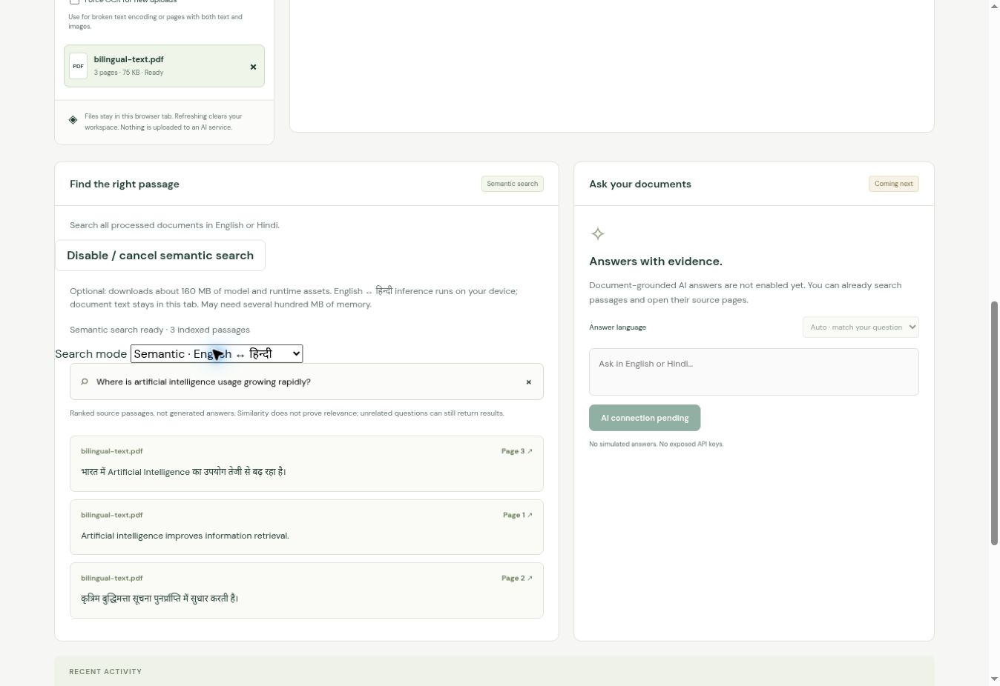

# DocAnswerly AI

*Upload Documents. Ask Questions. Get Answers.*

*An AI-powered multilingual document intelligence platform for extracting knowledge and answering questions from English and Hindi PDF documents.*

**[Open the live demo](https://harshvtomar.github.io/docanswerly-ai/)** · v0.2.0

Session 2 adds genuine browser-local multilingual semantic retrieval and optional
hybrid search to the English/Hindi PDF reader and OCR pipeline. **Experimental opt-in local Qwen3 generation is implemented.** Its 30-case evaluation completed, but cross-language answers and abstention remain unreliable. See [actual RAG results](docs/RAG_EVALUATION.md). Retrieved passages alone are not AI answers.



## Try it

1. Open the live demo and choose **Try a bilingual sample**, or upload your PDF.
2. Inspect extracted text and use the **Original PDF** tab and page arrows.
3. Search `बुद्धिमत्ता`, `भारत`, or `retrieval`. Click a result to open its page.
4. Choose **Enable local semantic search**, allow the ~160 MB model/runtime
   download, then select **Semantic**. Try `Where is artificial intelligence usage
   growing rapidly?` and open the page-3 result. All inference stays on your device.
5. **Hybrid** combines keyword and semantic ranks but performed worse for
   cross-language queries in our small evaluation. It is optional, not the default.
6. For broken embedded encoding or mixed text/image pages, select **Force OCR**
   before uploading again. English and Hindi OCR run together.

Files and extracted text stay in tab memory. Refreshing clears the workspace.
No account or API key is required. No uploaded documents are sent to an AI service.

## Verified features

| Feature | v0.2.0 status |
|---|---|
| React/TypeScript responsive frontend | Deployed on GitHub Pages |
| English, Hindi and mixed searchable PDFs | Verified on synthetic fixtures |
| English, Hindi and mixed scanned PDFs | Verified with genuine Tesseract OCR |
| PDFs mixing text and scanned pages | Verified with a two-page hybrid fixture |
| Upload, library, delete, progress and errors | Implemented and browser-tested |
| Original PDF viewer and page navigation | Implemented and browser-tested |
| Local keyword search and page-linked excerpts | Implemented in English/Hindi |
| Multilingual semantic retrieval, including English ↔ Hindi | Real local q8 MiniLM, browser-tested |
| Optional hybrid RRF search | Implemented; known cross-language ranking weakness |
| Token-aware chunks and original-page citations | Implemented |
| AI-generated RAG answers | Experimental local Qwen3; known Hindi/abstention failures |
| External AI backend and persistence | Not deployed |

## Architecture and technologies

`PDF → validation → PDF.js text extraction → Tesseract OCR fallback → Unicode normalization → page-aware chunks → keyword search → source page`

React 19, TypeScript 7, Vite 8, PDF.js 6.4, Tesseract.js 7, Vitest and Playwright.
Exact versions/integrity are pinned in package-lock.json. Plain CSS with bundled
DM Sans, Manrope and Noto Sans Devanagari. GitHub Pages serves static assets;
there is no backend execution on Pages.

Implemented retrieval: page chunks → token-aware splitting → local multilingual
embeddings → semantic / optional hybrid ranking → source pages.
Experimental generation: selected passages → local Qwen3/Wllama → structural citation validation. Reliable grounding and abstention remain future work. See
[architecture](docs/ARCHITECTURE.md) and [roadmap](ROADMAP.md).

## Local development

Use Node.js 24 and npm. From a clean checkout:

```bash
ONNXRUNTIME_NODE_INSTALL_CUDA=skip npm ci
npm test
npm run test:pdf
npm run test:retrieval
npm run dev
```

`npm run dev` prepares local PDF/OCR assets first. Initial preparation downloads
versioned English/Hindi language data and pinned model assets, verifying SHA-256
hashes. Model details are in [retrieval evaluation](docs/RETRIEVAL_EVALUATION.md). It requires
network access; processing in the deployed app uses same-origin assets.

```bash
npm run build
npx playwright install --with-deps chromium
npm run test:e2e
```

Browser tests start a production preview on port 4173 automatically. In restricted
agent environments, use the GitHub Actions browser runner. `npm run preview` serves
an existing build. Open the printed URL with `/docanswerly-ai/` appended.

## Reproducible checks

Session 1's 42-check baseline is preserved. Session 2 adds real inference,
retrieval integrity and cancellation checks. See [actual counts](docs/TEST_RESULTS.md).
OCR CER on the original clean synthetic sentences: English 0%, Hindi 5.17%, mixed
0%; not general OCR accuracy. Semantic Recall@1/3/5 and MRR were 1.0 on 25 simple
synthetic development queries. Keyword Recall@1 was 0.60; hybrid also 0.60, so
hybrid is not recommended for cross-language queries. No held-out generalization
or negative-query abstention is claimed. [Full evaluation and failures](docs/RETRIEVAL_EVALUATION.md).

Fixtures and regeneration instructions: [public/fixtures](public/fixtures/README.md).
The CI workflow repeats tests, PDF evaluation, build, and Chromium desktop/mobile
checks before official Pages deployment. Browser artifacts are retained 14 days.

## Tested limitations

- 25 MiB and 40 pages per file; eight documents per tab; no persistence.
- OCR is imperfect, especially with noisy scans, handwriting and complex layouts.
  Handwriting is not validated. Engine confidence is not calibrated accuracy.
- Text-overlay fixtures are small and synthetic; arbitrary Hindi font encodings,
  table reconstruction, multi-column ordering and rotated pages are not validated.
- Mixed text/image content within one page may require force OCR.
- OCR cancellation and timeouts are implemented; initialization cleanup waits for
  the worker handle. Large scans can be slow. Cancelling discards the unfinished PDF.
- No password-protected PDF support. Generated answers can be wrong despite valid citation IDs.
- Semantic model: 128 tokens per passage/query, 500 token-sized passages per index.
  Large download/memory footprint; unsupported questions still return ranked passages.
- Chrome and emulated Pixel 7 were tested; Safari and physical mobile testing remain.

## Security and deployment

Never put private keys in `VITE_*` variables or commit personal PDFs. No backend
credentials are required. Before future shared storage, implement authentication
and per-document ownership checks. See [deployment](docs/DEPLOYMENT.md).

## Continue development

Read [PROJECT_STATE.md](PROJECT_STATE.md), [SESSION_LOG.md](SESSION_LOG.md), and
[NEXT_SESSION_PROMPT.md](NEXT_SESSION_PROMPT.md). Inspect remote `main` before
continuing; never restart or create a replacement repository.

MIT application license. Third-party libraries/fonts retain their licenses;
see [THIRD_PARTY_NOTICES.md](THIRD_PARTY_NOTICES.md).
