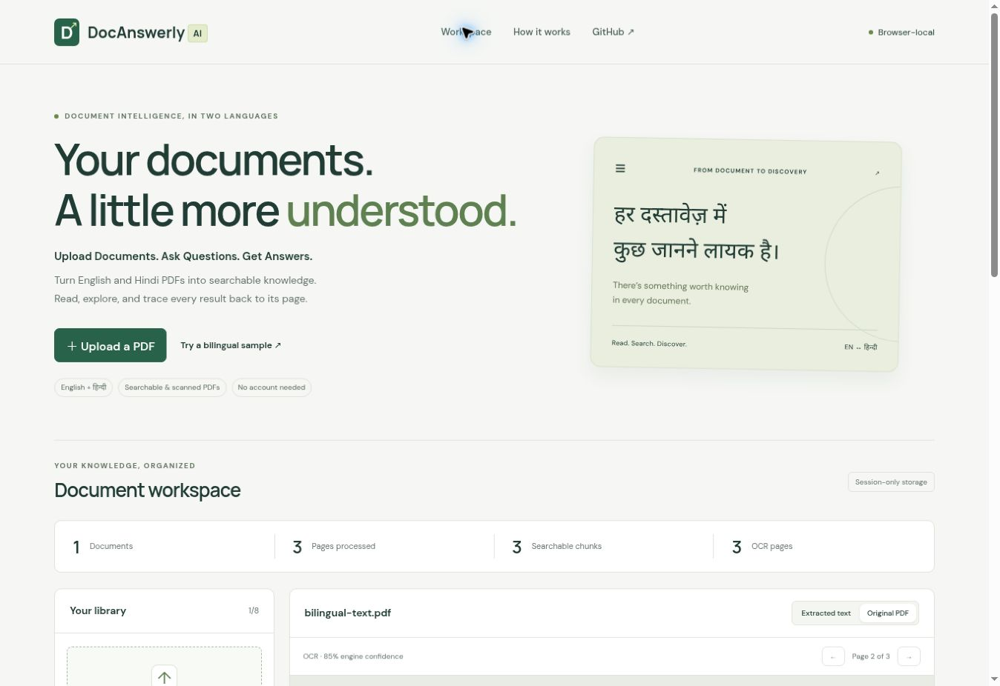

# DocAnswerly AI

*Upload Documents. Ask Questions. Get Answers.*

*An AI-powered multilingual document intelligence platform for extracting knowledge and answering questions from English and Hindi PDF documents.*

**[Open the live demo](https://harshvtomar.github.io/docanswerly-ai/)** · v0.1.0

Session 1 delivers a working, browser-local PDF reader, English/Hindi OCR and
page-linked keyword search. **Generative question answering and multilingual
semantic retrieval are pending.** The product vision above is not a claim that
LLM inference is already connected.



## Try it

1. Open the live demo and choose **Try a bilingual sample**, or upload your PDF.
2. Inspect extracted text and use the **Original PDF** tab and page arrows.
3. Search `बुद्धिमत्ता`, `भारत`, or `retrieval`. Click a result to open its page.
4. For broken embedded encoding or mixed text/image pages, select **Force OCR**
   before uploading again. English and Hindi OCR run together.

Files and extracted text stay in tab memory. Refreshing clears the workspace.
No account or API key is required. No uploaded documents are sent to an AI service.

## Verified features

| Feature | v0.1.0 status |
|---|---|
| React/TypeScript responsive frontend | Deployed on GitHub Pages |
| English, Hindi and mixed searchable PDFs | Verified on synthetic fixtures |
| English, Hindi and mixed scanned PDFs | Verified with genuine Tesseract OCR |
| PDFs mixing text and scanned pages | Verified with a two-page hybrid fixture |
| Upload, library, delete, progress and errors | Implemented and browser-tested |
| Original PDF viewer and page navigation | Implemented and browser-tested |
| Local keyword search and page-linked excerpts | Implemented in English/Hindi |
| Page-aware chunks and semantic provider interface | Implemented foundation |
| Cross-language semantic model, RAG answers | Not integrated |
| External AI backend and persistence | Not deployed |

## Architecture and technologies

`PDF → validation → PDF.js text extraction → Tesseract OCR fallback → Unicode normalization → page-aware chunks → keyword search → source page`

React 19, TypeScript 7, Vite 8, PDF.js 6.4, Tesseract.js 7, Vitest and Playwright.
Exact versions/integrity are pinned in package-lock.json. Plain CSS with bundled
DM Sans, Manrope and Noto Sans Devanagari. GitHub Pages serves static assets;
there is no backend execution on Pages.

Future RAG: chunks → genuine multilingual embeddings → hybrid retrieval/reranking
→ secure LLM inference → validated citations and abstention. See
[architecture](docs/ARCHITECTURE.md) and [roadmap](ROADMAP.md).

## Local development

Use Node.js 24 and npm. From a clean checkout:

```bash
npm ci
npm test
npm run test:pdf
npm run dev
```

`npm run dev` prepares local PDF/OCR assets first. Initial preparation downloads
versioned English/Hindi language data and verifies SHA-256 hashes. It requires
network access; processing in the deployed app uses same-origin assets.

```bash
npm run build
npx playwright install --with-deps chromium
npm run test:e2e
```

Browser tests start a production preview on port 4173 automatically. In restricted
agent environments, use the GitHub Actions browser runner. `npm run preview` serves
an existing build. Open the printed URL with `/docanswerly-ai/` appended.

## Reproducible checks

15 unit tests + 7 PDF evaluation checks + 20 desktop/mobile browser tests passed;
0 failures and 0 skipped in the verified Session 1 run. [Full results and limitations](docs/TEST_RESULTS.md).
OCR CER on one clean synthetic sentence per language: English 0%, Hindi 5.17%,
mixed 0%. This is **not** general OCR accuracy. Source references and actual outputs
are saved in [evaluation.json](docs/evaluation.json). Retrieval Recall@K is not
reported because no real semantic model is integrated.

Fixtures and regeneration instructions: [public/fixtures](public/fixtures/README.md).
The CI workflow repeats tests, PDF evaluation, build, and Chromium desktop/mobile
checks before official Pages deployment. Browser artifacts are retained 14 days.

## Tested limitations

- 25 MiB and 40 pages per file; eight documents per tab; no persistence.
- OCR is imperfect, especially with noisy scans, handwriting and complex layouts.
  Handwriting is not validated. Engine confidence is not calibrated accuracy.
- Text-overlay fixtures are small and synthetic; arbitrary Hindi font encodings,
  table reconstruction, multi-column ordering and rotated pages are not validated.
- Mixed text/image content within one page may require force OCR.
- OCR cancellation and timeout recovery are pending; large scans can be slow.
- No password-protected PDF support. No semantic/cross-language search or AI answers.
- Chrome and emulated Pixel 7 were tested; Safari and physical mobile testing remain.

## Security and deployment

Never put private keys in `VITE_*` variables or commit personal PDFs. No backend
credentials are required. Before future shared storage, implement authentication
and per-document ownership checks. See [deployment](docs/DEPLOYMENT.md).

## Continue development

Read [PROJECT_STATE.md](PROJECT_STATE.md), [SESSION_LOG.md](SESSION_LOG.md), and
[NEXT_SESSION_PROMPT.md](NEXT_SESSION_PROMPT.md). Inspect remote `main` before
continuing; never restart or create a replacement repository.

MIT application license. Third-party libraries/fonts retain their licenses;
see [THIRD_PARTY_NOTICES.md](THIRD_PARTY_NOTICES.md).
